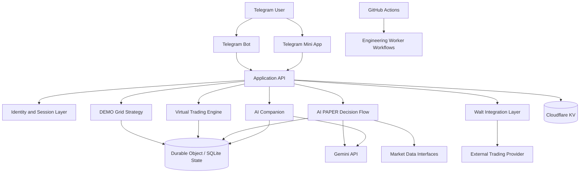

# CryptoGuru — Architecture Overview

> Public technical overview for prospective acquirers. This document describes the intended and code-level architecture; it is not a deployment attestation.

## 1. System at a glance

CryptoGuru is structured as a Telegram-facing application backed by serverless services, persistent state, virtual-trading components and external AI/market-data integrations.

The diagram is a logical representation of the system boundaries. Exact runtime topology, deployed bindings, secrets and provider connectivity must be confirmed during technical due diligence.

## 2. Application surfaces

### Telegram Bot
The bot provides the Telegram entry point and coordinates user-facing interactions with backend functionality.

### Telegram Mini App
The Mini App is a web interface organized around major product areas:
- Wallet and account presentation
- Trading
- Agents
- AI Companion

The wallet area is an application account interface. It should not be interpreted as a self-custody blockchain wallet unless separately demonstrated and verified.

## 3. Backend and persistence

The backend is primarily TypeScript and targets Cloudflare's serverless environment. The codebase uses or is designed around:
- Cloudflare Workers for request handling and application services
- Durable Objects for coordinated, stateful workflows
- SQLite-backed Durable Object storage for structured persistent state
- Cloudflare KV for key-value data and supporting application state

The Trading Engine uses a Durable Object-oriented design with persistent records for virtual trading state, accounting and event history.

## 4. Trading components

### DEMO / Grid
The Grid strategy implements rule-based virtual trading. Its code covers grid levels, virtual orders and positions, take-profit/stop-loss behavior, range management and risk-related limits.

### Virtual Trading Engine
The engine provides shared simulation primitives, including:
- Virtual position opening and closing
- LONG and SHORT position handling
- Margin and notional calculations
- PnL, fees and slippage simulation
- Simulated liquidation
- Take-profit and stop-loss handling
- Idempotency and concurrency protections
- Persistence and recovery-oriented logic

These are simulation capabilities. They do not establish that orders are executed on a live exchange.

### AI PAPER
The AI PAPER path obtains market context, requests structured decisions from an AI model and persists decision data. The broader autonomous lifecycle — signal, risk validation, position opening, ongoing management and closing — must be treated as incomplete until the relevant changes are merged, tested and demonstrated end to end.

### LIVE / Walt
The Walt integration layer contains OAuth 2.1 / PKCE and MCP-oriented integration code, account and position access paths, previews and guarded execution-related operations. The live path is deliberately not represented as production-ready. Current code-level gates and incomplete close/accounting behavior prevent a claim of safe real-money execution.

## 5. AI services

### AI Companion
The Companion provides conversational modes for general assistance, learning and research. Its implementation includes conversation persistence, context handling, attachment processing, quotas and request coordination.

### AI decision generation
Gemini is used for AI-assisted decision generation and Companion responses. AI output is application input, not an independently verified trading signal. It must remain subject to deterministic validation, risk controls and operational monitoring.

## 6. Market data and external integrations

The codebase includes interfaces for Hyperliquid market data and a Walt MCP integration. The presence of an adapter or API client does not prove that credentials are configured, that a provider is reachable in production, or that a specific account can trade.

## 7. Engineering automation

GitHub Actions workflows coordinate task-oriented engineering workers. The workflows are finite jobs triggered by repository events or schedules; they should not be described as permanently running autonomous agents. Successful operation depends on workflow configuration, repository permissions, model credentials and runtime execution.

## 8. Key architectural boundaries

| Boundary | What the code can demonstrate | What still needs operational proof |
|---|---|---|
| Telegram | Bot and Mini App integration code | Current bot availability and deployed Mini App behavior |
| Backend | API and serverless implementation | Current production deployment, bindings and secrets |
| DEMO | Virtual strategy and risk logic | Production smoke tests and observed runtime behavior |
| AI PAPER | AI decision generation and persistence | Complete autonomous lifecycle and validated risk enforcement |
| LIVE / Walt | Integration and guarded execution groundwork | Provider contract validation, accounting, close path, kill switch and safe end-to-end tests |
| Worker automation | Workflow definitions and task coordination | Reliable workflow runs and configured credentials |

## 9. Due-diligence evidence

A buyer should request:
1. A pinned commit SHA for the exact source version being evaluated.
2. Current CI results for that SHA.
3. A live demonstration using a non-production account or controlled test environment.
4. Cloudflare deployment and binding inventory, with secrets redacted.
5. Provider integration evidence and current API schemas.
6. A walkthrough of state persistence, recovery and risk enforcement.
7. A list of third-party services, licenses and operational costs.

---
*This document is a high-level architecture guide. It does not replace source review, deployment inspection or an independent security assessment.*
